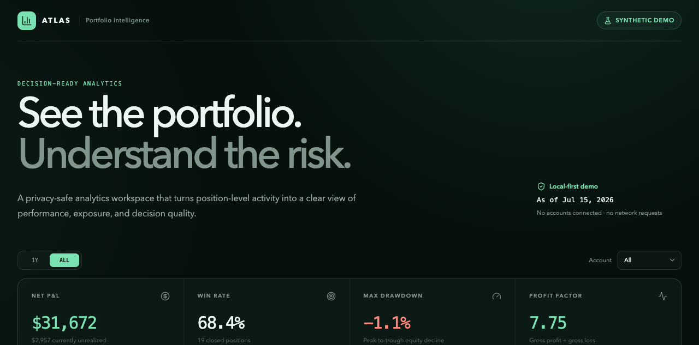

# Atlas Portfolio Analytics

A recruiter-friendly product engineering showcase: an interactive portfolio intelligence dashboard that turns position-level activity into clear performance, exposure, and risk signals.

The application is intentionally privacy-safe. Every company, symbol, price, position, and outcome is fictional and deterministic. There are no brokerage connections, cookies, tokens, personal financial records, or network requests.



## What it demonstrates

- Product judgment: a dense financial workflow reduced to the questions an operator needs to answer quickly.
- Frontend craft: responsive React UI, interactive filters, accessible controls, and purposeful data visualization.
- Analytical modeling: long/short-aware P&L, realized versus unrealized performance, win rate, profit factor, equity curve, drawdown, monthly outcomes, and exposure concentration.
- Engineering discipline: strict TypeScript, isolated pure calculations, unit tests, linting, production builds, and GitHub Actions CI.
- Privacy by design: a useful live demo without exposing a real account, provider integration, credential flow, or proprietary strategy.

## Product tour

The dashboard supports:

- one-year and all-history views;
- Core, Tactical, and combined account filters;
- an interactive equity curve and current exposure allocation;
- monthly outcome comparison;
- marked-to-demo-price open positions with direction-aware returns.

All panels derive from the same filtered trade set, so changing a control updates the full analytical story—not just one chart.

## Run locally

Requires Node.js 22+.

```bash
npm install
npm run dev
```

Open [http://localhost:4173](http://localhost:4173).

## Verify

```bash
npm run verify
```

This runs ESLint, Vitest unit tests, strict TypeScript compilation, and a production Vite build. The same verification runs in GitHub Actions.

## Architecture

The application uses a one-way data flow:

```text
synthetic fixtures → pure analytics layer → filtered view model → React + Recharts UI
```

See [docs/ARCHITECTURE.md](docs/ARCHITECTURE.md) for the design boundaries and a production extension path.

## Repository setup

Suggested GitHub description, topics, homepage guidance, and social-preview guidance are in [.github/REPOSITORY_METADATA.md](.github/REPOSITORY_METADATA.md).

## Tech stack

React 19 · TypeScript · Vite · Recharts · Vitest · ESLint · GitHub Actions

## License

[MIT](LICENSE)
