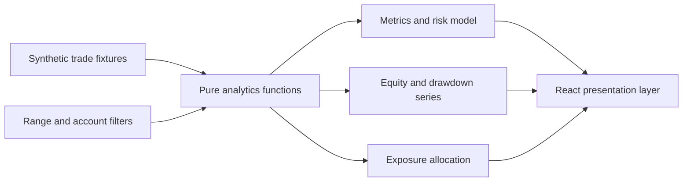

# Architecture

Atlas is deliberately static and local-first. The public showcase has no backend, authentication flow, account connector, cookies, secrets, or telemetry.

## Design choices

- **Deterministic fixtures:** every value is invented and checked into source control, so reviewers see the same product without configuration.
- **Pure analytics layer:** calculations live outside React in `src/lib/analytics.ts`, keeping them testable and making a future data-source adapter straightforward.
- **Derived UI state:** filters select a trade set; all metrics, charts, exposures, and position lists recompute from that one set.
- **Privacy boundary:** there is no network client and no browser-storage access. A production version would put broker-specific adapters behind a server-side boundary and normalize their output into the `Trade` interface.

## Production extension path

1. Add a read-only ingestion service with provider-specific adapters.
2. Validate and normalize events into the `Trade` contract.
3. Store encrypted, tenant-scoped records behind an authenticated API.
4. Preserve the current frontend analytics contract while moving heavier calculations to an auditable portfolio service.
5. Add reconciliation, stale-data indicators, and source provenance before enabling live positions.

## Verification

`npm run verify` runs linting, unit tests, TypeScript compilation, and a production bundle build. GitHub Actions runs the same command for pushes and pull requests.
